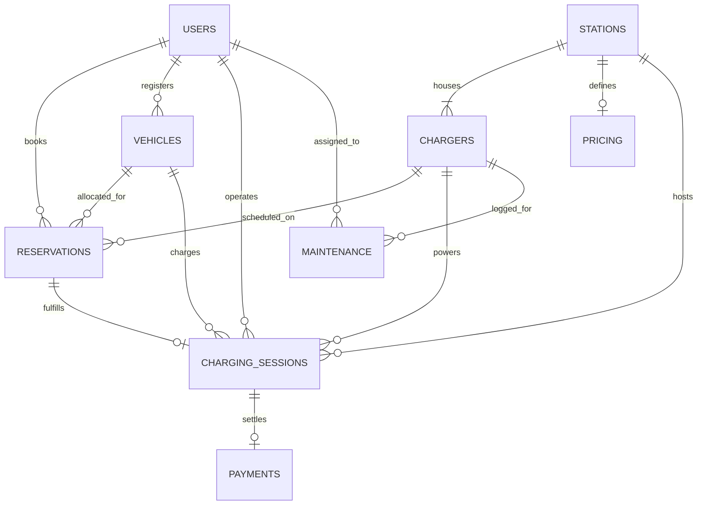

# LWP Review 02: Dynamic EV Charging Station Management System
## Web Technology Course — Individual Project Defense & Presentation Guide

**Project Title:** EV Charging Station Management System  
**Stage:** Stage 2 — Dynamic Web Application (PHP, MySQL, Apache, Bootstrap 5, JavaScript)  
**Academic Review:** LWP Review 02  
**Presenter:** Student (Individual Project)  
**Technology Stack:** PHP 8.2 (PDO), MySQL 8.0, Apache 2.4 (XAMPP), HTML5, CSS3, JavaScript (ES6+), Bootstrap 5.3.3, Chart.js  

---

# Presentation Slide Deck (15 Slides)

```text
┌────────────────────────────────────────────────────────────────────────┐
│                   LWP REVIEW 02 — SLIDE OUTLINE                        │
├────────────────────────────────────────────────────────────────────────┤
│ Slide 01: Project Title & Introduction                                 │
│ Slide 02: Transition from Stage 1 (Static) to Stage 2 (Dynamic)       │
│ Slide 03: System Architecture & Three-Tier Layer Model                │
│ Slide 04: MySQL Database Design & Relational Schema (3NF)              │
│ Slide 05: Entity-Relationship (ER) Model & Foreign Keys               │
│ Slide 06: Role-Based Access Control (RBAC) & Session Management        │
│ Slide 07: Critical Algorithm 1: Double-Booking Conflict Prevention    │
│ Slide 08: Critical Algorithm 2: Maintenance Bay Lockout & Lifecycle    │
│ Slide 09: Charging Session Life-Cycle & Energy Metering Formula       │
│ Slide 10: Dynamic Pricing, Service Fee & GST Invoicing Engine         │
│ Slide 11: 5 Academic Operational Intelligence Reports & CSV Export    │
│ Slide 12: Real-Time Dashboard & SQL Aggregation Metrics               │
│ Slide 13: Security Architecture (PDO, SQLi Prevention, XSS, Hashing)  │
│ Slide 14: Live Demonstration Walkthrough & Workflow Verification      │
│ Slide 15: Conclusion, Academic Learning Outcomes & Viva Q&A Ready      │
└────────────────────────────────────────────────────────────────────────┘
```

---

### Slide 01: Title & Executive Summary
* **Title:** EV Charging Station Management System
* **Domain:** Electric Vehicle Charging Infrastructure Operations & Energy Management
* **Academic Review Goal:** Demonstrate a fully functional dynamic web application using PHP and MySQL under XAMPP, extending the Stage 1 client-side UI with zero regression.
* **Core Problem Statement:**
  > *"Which charger is available, when can the customer use it, how much energy will be consumed, how long will charging take, and what will the estimated cost be?"*
  > 
  > *"How efficiently are our charging hubs and high-power DC chargers being utilized?"*

---

### Slide 02: Transition from Stage 1 to Stage 2
| Dimension | Stage 1 (Review 01) | Stage 2 (Review 02 - Current) |
| :--- | :--- | :--- |
| **Data Storage** | Client-side `localStorage` & in-memory JS | Persistent MySQL Database (`ev_charging_db`) |
| **Server Engine** | Static file serving / Browser | Apache 2.4 + PHP 8.2 (XAMPP) |
| **Authentication** | Simulated role switching | PHP Session Auth + `password_hash()` BCRYPT |
| **Conflict Handling**| Client-side date check | Atomic SQL overlapping window conflict query |
| **Maintenance** | Local flag toggle | Database Foreign Key lockout + auto bay status sync |
| **Reporting** | Static UI tables | 5 Real-Time SQL Reports + RFC CSV export |
| **Architecture** | Client-Only Single-Tier | Full Three-Tier Client-Server Architecture |

---

### Slide 03: System Architecture (Three-Tier Enterprise Model)
```mermaid
graph TD
    subgraph Presentation Tier (Frontend)
        UI[HTML5 / CSS3 / Bootstrap 5.3]
        JS[Vanilla JS Controllers & Chart.js]
    end

    subgraph Application Tier (PHP Backend)
        API[RESTful JSON Endpoints /api/*.php]
        Auth[Session Guard & RBAC Engine]
        BizLogic[Double-Booking / Billing / Lockout Engine]
    end

    subgraph Data Tier (MySQL Database)
        DB[(ev_charging_db - InnoDB Engine)]
        Tables[10 Normalized Relational Tables]
    end

    UI -->|Async fetch / JSON| API
    JS -->|AJAX Requests| API
    API --> Auth
    Auth --> BizLogic
    BizLogic -->|PDO Prepared Statements| DB
    DB --> Tables
```

---

### Slide 04: MySQL Relational Database Design
The schema `ev_charging_db` is normalized to Third Normal Form (3NF) to eliminate data redundancy and anomalies:
1. `users`: Authentication, bcrypt password hashes, and 4 system roles (`Admin`, `Station_Manager`, `Technician`, `Customer`).
2. `stations`: Physical charging station network across Coimbatore & South India.
3. `pricing`: Station-specific tariff rates (₹/kWh), service fees, and GST tax percentages.
4. `chargers`: Hardware bays, connector standards (`CCS2`, `Type 2`, `CHAdeMO`, `GB/T`), power ratings (7.4 kW to 150 kW), status flags.
5. `vehicles`: EV models (Tata Nexon, Porsche Taycan, Mercedes EQS, BMW iX, Tesla Model 3), battery capacities, and max DC charge rates.
6. `reservations`: Time-slotted reservations with foreign keys to station, charger, vehicle, and user.
7. `charging_sessions`: Active and completed charging sessions tracking energy throughput (kWh), duration, and cost.
8. `payments`: Payment receipts with UPI/Card/RFID reference codes and settlement status.
9. `maintenance`: Work orders, fault priorities, technician assignments, and remarks.
10. `notifications`: Real-time system dispatch alerts.

---

### Slide 05: Entity-Relationship (ER) Schema Overview


---

### Slide 06: Role-Based Access Control (RBAC) & Sessions
* **Admin:** Full administrative control (CRUD stations, chargers, users, reports, pricing).
* **Station Manager:** Station-level metrics, charger status monitoring, station utilization, revenue review.
* **Technician:** Maintenance tickets queue, diagnostic remarks logging, resolution and bay unlocking.
* **Customer:** Search charging hubs, check live availability, reserve slots, register EVs, view invoices.
* **Implementation:** Secure server-side PHP session tokens (`$_SESSION['user_id']`, `$_SESSION['role']`) with API guards:
  ```php
  requireRole(['Admin', 'Station_Manager']); // Enforced via config/session.php
  ```

---

### Slide 07: Critical Algorithm 1 — Double-Booking Conflict Prevention
To prevent multiple vehicles from booking the same charger during overlapping time intervals:

$$\text{Overlap Condition: } (\text{New Start} < \text{Existing End}) \land (\text{New End} > \text{Existing Start})$$

#### Executed SQL Prepared Query:
```sql
SELECT reservation_id, reservation_code, start_time, duration_minutes 
FROM reservations
WHERE charger_id = :charger_id
  AND reservation_date = :res_date
  AND status NOT IN ('Cancelled', 'Completed')
  AND (
      TIME(:new_start1) < ADDTIME(start_time, SEC_TO_TIME(duration_minutes * 60))
      AND ADDTIME(TIME(:new_start2), SEC_TO_TIME(:new_duration * 60)) > start_time
  )
LIMIT 1;
```
* **Outcome:** If a conflict exists, the transaction aborts with HTTP 409 Conflict, returning details of the conflicting slot without modifying the database.

---

### Slide 08: Critical Algorithm 2 — Hardware Fault Lockout Lifecycle
When a hardware fault or safety hazard is reported:
1. **Fault Intake:** Ticket created in `maintenance` table via `api/maintenance.php`.
2. **Atomic Bay Lockout:** The target charger's status is immediately updated to `'Maintenance'`:
   ```sql
   UPDATE chargers SET status = 'Maintenance' WHERE charger_id = :cid;
   ```
3. **Reservation Rejection (Rule 43):** Any attempt to reserve a charger with status `'Maintenance'` or `'Offline'` is rejected with HTTP 409.
4. **Resolution & Restoration:** When the technician marks the ticket `'Completed'`, the system automatically restores `chargers.status` to `'Available'`.

---

### Slide 09: Energy Metering & Battery Dynamics Formula
* **Energy Required ($E$ in kWh):**
  $$E = \text{Battery Capacity (kWh)} \times \frac{\text{Target \%} - \text{Current \%}}{100}$$
* **Ideal Charging Duration ($T$ in hours):**
  $$T = \frac{E}{\min(\text{Charger Power (kW)}, \text{Vehicle Max Intake (kW)})}$$
* **Realistic Charging Curve Factor:**
  The simulation accommodates the CC-CV (Constant Current - Constant Voltage) taper when battery state of charge (SoC) crosses 80%.

---

### Slide 10: Dynamic Pricing, Service Fee & Tax Invoicing
* **Energy Charge:**
  $$\text{Energy Cost} = E \times \text{Tariff Rate (₹/kWh)}$$
* **Station Service Fee:** Fixed ₹20.00 infrastructure handling fee.
* **Goods & Services Tax (GST 18%):**
  $$\text{GST} = (\text{Energy Cost} + \text{Service Fee}) \times 0.18$$
* **Gross Invoice Amount:**
  $$\text{Total Invoice (₹)} = \text{Energy Cost} + \text{Service Fee} + \text{GST}$$
* **Persistence:** Stored in `charging_sessions` and itemized in `payments` table with UPI/Card transaction references.

---

### Slide 11: Five Academic Operational Intelligence Reports
Endpoint `api/reports.php` provides real-time reporting with direct RFC-compliant CSV export:
1. **Charging Sessions Report:** Detailed audit of each session (customer, station, bay, vehicle, kWh, tariff, GST, total).
2. **Energy Consumption Report:** Electrical throughput per charger bay and station hub.
3. **Station Revenue Report:** Tariff revenue, completed session volume, service fee collection, and gross earnings.
4. **Charger Utilization Report:** Formula:
   $$\text{Utilization \%} = \frac{\text{Total Charging Hours}}{\text{Operating Hours (30 days)}} \times 100$$
5. **Maintenance & Fault History Report:** Downtime audit, severity, assigned technician, and resolution remarks.

---

### Slide 12: Real-Time Operational Dashboard
The central dashboard displays 8 real-time aggregated KPI metrics queried directly via MySQL:
* **Total Stations:** `COUNT(station_id) FROM stations`
* **Total Chargers:** `COUNT(charger_id) FROM chargers`
* **Available Chargers:** `COUNT(*) FROM chargers WHERE status = 'Available'`
* **Currently Charging:** `COUNT(*) FROM chargers WHERE status = 'Charging'`
* **Under Maintenance:** `COUNT(*) FROM chargers WHERE status = 'Maintenance'`
* **Active Sessions:** `COUNT(*) FROM charging_sessions WHERE status = 'Active'`
* **Today's Energy Throughput:** Aggregated kWh delivered.
* **Today's Revenue:** Gross INR collected.

---

### Slide 13: Web Application Security Architecture
* **SQL Injection Prevention:** 100% of database interactions use PDO Prepared Statements with parameterized queries. Zero raw SQL string concatenation.
* **Password Security:** Sensitive credentials encrypted using PHP's native `password_hash($pass, PASSWORD_BCRYPT)`.
* **Cross-Site Scripting (XSS) Prevention:** Output sanitized using `htmlspecialchars()` and JSON encoding helpers.
* **Cross-Origin Resource Sharing (CORS):** Clean standard JSON response envelopes (`sendJsonResponse()`).
* **Input Validation:** Strict server-side type casting and validation on all POST payloads.

---

### Slide 14: Live Demonstration Walkthrough
```text
Step 1: Open http://localhost/EV/setup_database.php (Verify 10/10 tables healthy)
Step 2: Navigate to http://localhost/EV/ (Landing page with live counters)
Step 3: Open Dashboard (pages/dashboard.html) -> Observe 8 KPIs
Step 4: Register Luxury EV (pages/vehicles.html) -> Porsche Macan EV
Step 5: Slot Reservation (pages/reservations.html) -> Test Conflict Detection (Rule 42)
Step 6: Maintenance Dispatch (pages/maintenance.html) -> Trigger Fault & Bay Lockout (Rule 43)
Step 7: Charging Session (pages/charging-session.html) -> Run Live Simulation & Complete
Step 8: Billing (pages/billing.html) -> Inspect Itemized Tax Invoice & Settle
Step 9: Reports (pages/reports.html) -> Switch across 5 tabs & Download CSV
```

---

### Slide 15: Academic Learning Outcomes & Viva Questions
* **Client-Server Architecture:** Mastery of asynchronous AJAX/Fetch communication with a normalized relational database backend.
* **Transactional Integrity:** ACID guarantees using PDO transactions for multi-table operations (e.g. session completion + bay unlocking + invoice creation).
* **Defensive Programming:** Server-side validation, overlap time math, and role authorization.

#### Viva Q&A Preparation:
* **Q1: Why did you choose PDO over MySQLi?**
  * *Answer:* PDO supports prepared statements, object-oriented exception handling (`PDO::ERRMODE_EXCEPTION`), and is database agnostic.
* **Q2: How do you prevent double-booking if two users submit simultaneously?**
  * *Answer:* Through atomic SQL interval checks combined with database transactions (`beginTransaction()` / `commit()`).
* **Q3: What makes this an infrastructure management system rather than just a booking portal?**
  * *Answer:* It handles charger hardware specifications, power kW ratings, bay status monitoring, maintenance work order lifecycle, technician assignment, energy throughput analytics, and station utilization scores.

---
**Academic Review Stage 2 Status: 100% Complete & Verified on XAMPP (Apache/MySQL)**
